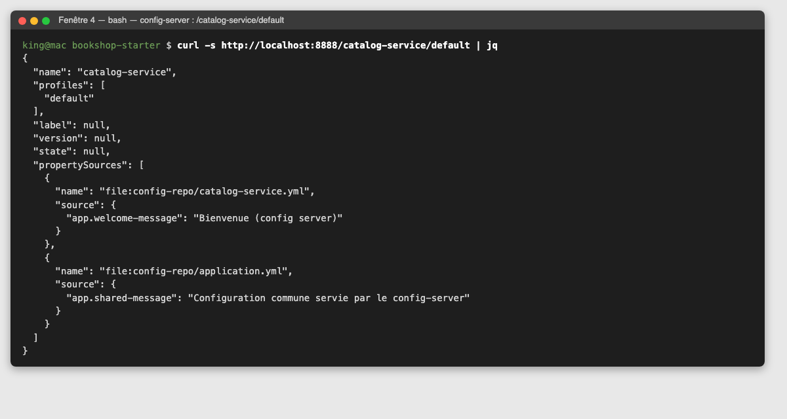
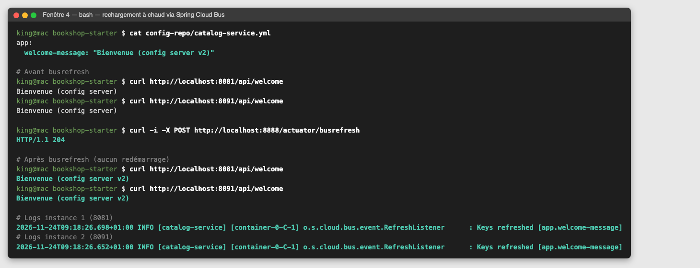
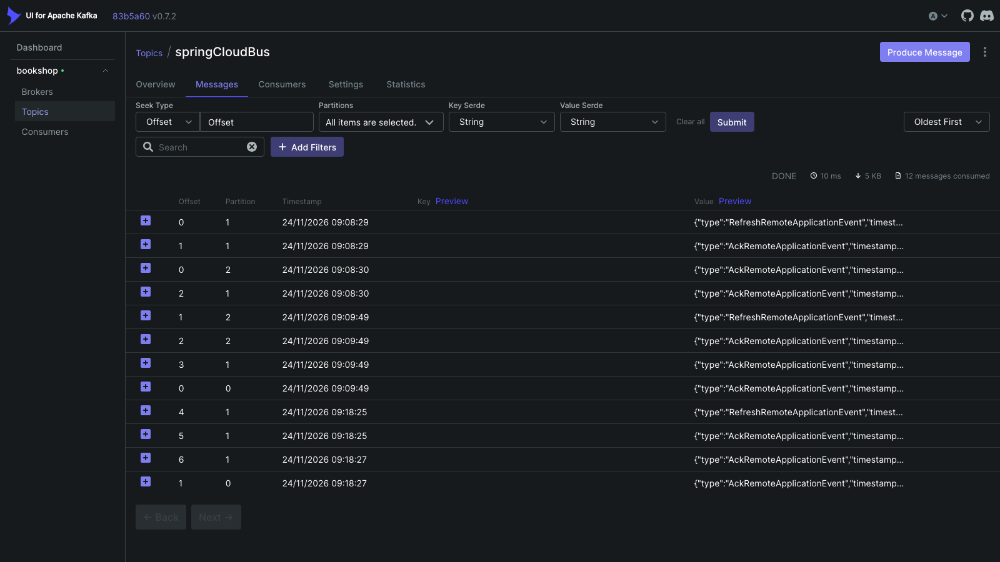

# TP2 – Configuration centralisée : rendu

INFAL112 – Projet bookshop-starter

## 1. Le config-server sert les deux sources de configuration

`curl -s http://localhost:8888/catalog-service/default | jq`

Il y a deux `propertySources` : `catalog-service.yml` (propre au service, prioritaire) puis `application.yml` (commun à tous les services).

## 2. Rechargement à chaud des deux instances en v2

Le fichier `config-repo/catalog-service.yml` passe en v2. Avant `busrefresh`, les deux instances (8081 et 8091) gardent l'ancienne valeur. Un seul `POST /actuator/busrefresh` sur le config-server (réponse `204`) les met toutes les deux à jour, sans redémarrage. Chaque instance logge `Keys refreshed [app.welcome-message]`.

> L'endpoint `/api/welcome` renvoie le message en texte brut (contrôleur demandé au TP1), d'où l'absence d'enveloppe JSON `{"message": ...}`.

## 3. L'ordre de rechargement dans Kafka

Kafka UI, topic `springCloudBus`, onglet Messages.

Chaque `busrefresh` produit un `RefreshRemoteApplicationEvent`, publié par le config-server. Il est suivi d'un `AckRemoteApplicationEvent` (accusé de réception) par service qui a traité l'ordre.

## 4. En trois phrases

Centraliser la configuration permet de modifier un paramètre à un seul endroit pour tous les services et toutes leurs instances, sans recompiler ni redéployer. Le bus (Spring Cloud Bus sur Kafka) diffuse un seul ordre de rechargement, publié dans le topic `springCloudBus`, à toutes les instances abonnées, qui relisent alors leur configuration à chaud. Le mot `optional:` permet au service de démarrer avec son fichier interne si le config-server est injoignable : on privilégie la disponibilité plutôt que la cohérence de la configuration.

## Checklist de validation

| Vérification | OK ? |
|---|---|
| `/catalog-service/default` liste `catalog-service.yml` et `application.yml` | ☑ |
| Le catalogue affiche « Fetching config from server » au démarrage | ☑ |
| `/api/welcome` renvoie « Bienvenue (config server) » sur 8081 et 8091 | ☑ |
| Après `busrefresh`, les deux instances renvoient la v2 sans redémarrage | ☑ |
| Le message `RefreshRemoteApplicationEvent` est visible dans `springCloudBus` | ☑ |
| Config-server arrêté : le catalogue démarre avec « fichier interne » | ☑ |

Étape 7.2 également vérifiée : après passage en v3 et `busrefresh`, l'instance 1 renvoie « Bienvenue (config server v3) », alors que l'instance 2, lancée avec `--app.welcome-message`, garde « Bienvenue (ligne de commande) ». L'argument de lancement reste prioritaire sur le config-server.
