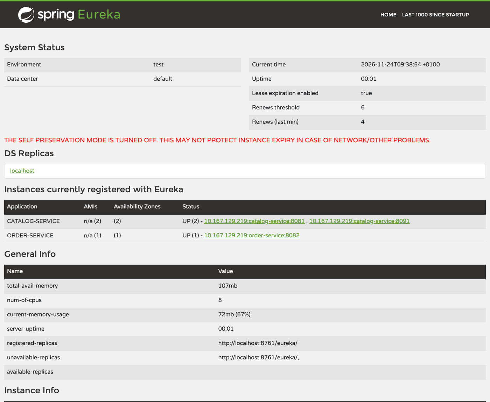
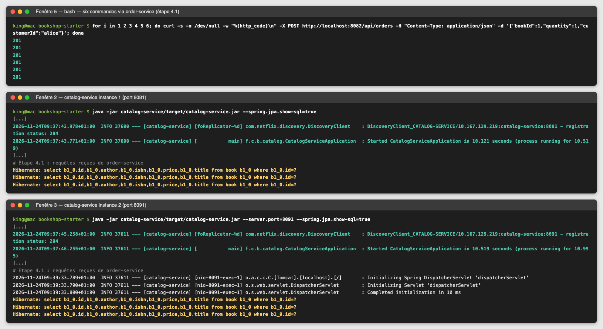
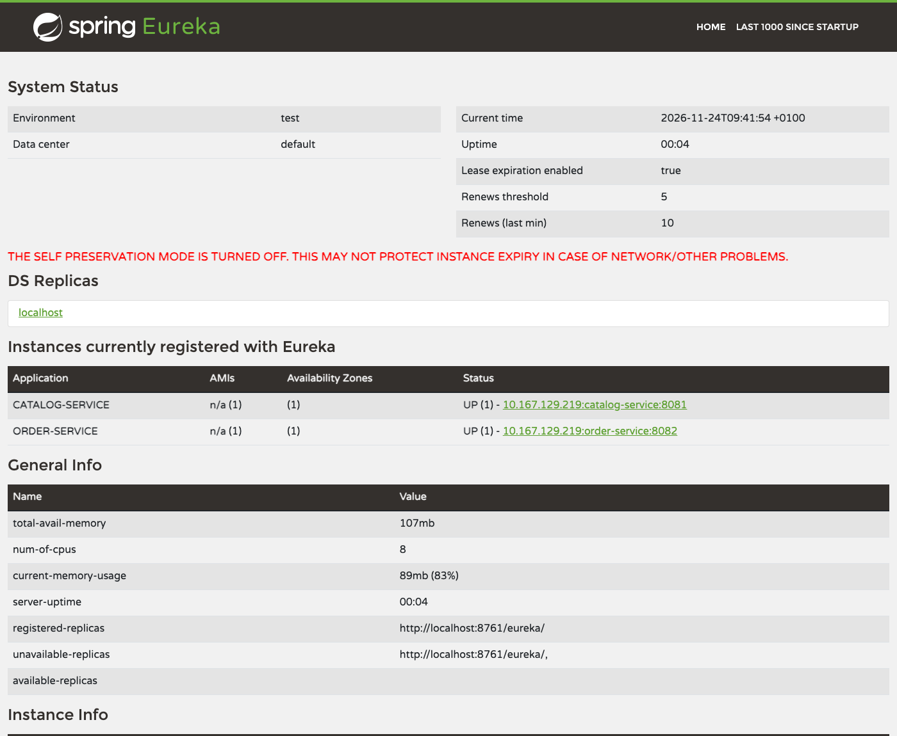

# TP3 – Découverte de services (Eureka) : rendu

INFAL112 – Projet bookshop-starter

Schémas explicatifs : [schemas/tp3-eureka.drawio](schemas/tp3-eureka.drawio), avec les onglets [architecture Eureka](schemas/tp3-1-architecture-eureka.png) et [round robin et perte d'instance](schemas/tp3-2-round-robin-perte-instance.png).

| Élément | Port | Rôle |
|---|---|---|
| `discovery-server` (nouveau module) | 8761 | Annuaire Eureka et son tableau de bord |
| `catalog-service`, instance 1 | 8081 | Inscrit sous le nom `CATALOG-SERVICE` |
| `catalog-service`, instance 2 | 8091 | Inscrit sous le même nom (deuxième copie) |
| `order-service` | 8082 | Inscrit, appelle `http://catalog-service` via l'annuaire |

## 1. Le tableau de bord Eureka



`CATALOG-SERVICE` est `UP (2)` (instances `catalog-service:8081` et `catalog-service:8091`) et `ORDER-SERVICE` est `UP (1)`. Chaque service a loggé `registration status: 204` au démarrage.

Vérification en ligne de commande :

```
$ curl -s -H "Accept: application/json" http://localhost:8761/eureka/apps | jq '.applications.application[] | {name, instances: (.instance | length)}'
{
  "name": "CATALOG-SERVICE",
  "instances": 2
}
```

> Remarque : juste après l'inscription, cette commande a d'abord renvoyé une liste vide alors que le tableau de bord affichait déjà les deux instances. L'API REST d'Eureka sert ses réponses depuis un cache rafraîchi toutes les 30 secondes ; le tableau de bord, lui, lit directement le registre.

## 2. Les appels sont répartis entre les deux instances

Six commandes passées via order-service (port 8082), qui ne connaît que le nom `http://catalog-service` :



Six réponses `201`. La requête `select ... from book b1_0 where b1_0.id=?` apparaît trois fois dans la console de l'instance 8081 et trois fois dans celle de l'instance 8091 : le round robin de Spring Cloud LoadBalancer alterne entre les deux. Dernière commande :

```json
{
  "id": 6,
  "bookId": 1,
  "quantity": 1,
  "customerId": "alice",
  "status": "CONFIRMED",
  "totalAmount": 15.00,
  "createdAt": "2026-11-24T08:39:34.764215Z"
}
```

## 3. Perte d'une instance

L'instance 2 (8091) est arrêtée proprement (SIGTERM, équivalent de Ctrl+C) à 09:40:46. Elle se désinscrit de l'annuaire (`deregister status: 200`), puis une commande est envoyée toutes les 3 secondes :

```
t+1s  503
t+4s  201
t+7s  503
t+10s 201
t+13s 503
t+16s 201
t+20s 503
t+23s 201
t+26s 503
t+29s 201
t+32s 503
t+35s 201   <- plus aucune erreur à partir d'ici
t+38s 201
t+41s 201
t+44s 201
t+47s 201
t+50s 201
```

Pendant environ 32 secondes, order-service utilise encore son ancienne liste d'instances : une commande sur deux part vers 8091, qui ne répond plus, et renvoie `503`. Une fois la liste rafraîchie, toutes les commandes aboutissent. La boucle lancée immédiatement après l'arrêt a renvoyé six `201` : l'instance 2 répondait encore pendant les quelques secondes de son arrêt propre.

Une minute plus tard, le tableau de bord affiche `CATALOG-SERVICE UP (1)` :



La boucle de l'étape 4.1, relancée, renvoie six `201`, et les six requêtes SQL arrivent toutes dans la console de l'instance 8081.

## 4. En trois phrases

`@LoadBalanced` ajoute au `RestClient.Builder` un intercepteur Spring Cloud LoadBalancer. Avant chaque appel, il remplace le nom de l'hôte par l'adresse d'une instance réelle, choisie à tour de rôle (round robin). L'adresse `http://catalog-service` fonctionne parce que ce nom n'est pas résolu par le DNS : c'est la clé sous laquelle les instances du catalogue se sont inscrites dans Eureka (leur `spring.application.name`), et order-service télécharge régulièrement ce registre pour obtenir leurs adresses. Quand une instance tombe, elle disparaît de l'annuaire, mais order-service garde l'ancienne liste en cache jusqu'au rafraîchissement suivant : pendant ce délai (environ 32 secondes ici), les appels envoyés vers l'instance morte échouent en `503`, puis tout repasse par l'instance restante.

## Checklist de validation

| Vérification | OK ? |
|---|---|
| http://localhost:8761 affiche le tableau de bord Eureka | ☑ |
| `CATALOG-SERVICE` apparaît avec `UP (2)` | ☑ |
| `ORDER-SERVICE` apparaît avec `UP (1)` | ☑ |
| `application.yml` de order-service contient `http://catalog-service` et plus aucun `localhost:8081` | ☑ |
| Six commandes renvoient `201`, et les requêtes SQL sont réparties entre 8081 et 8091 | ☑ |
| Après l'arrêt d'une instance, les commandes aboutissent de nouveau en moins de 90 secondes | ☑ (35 s) |
