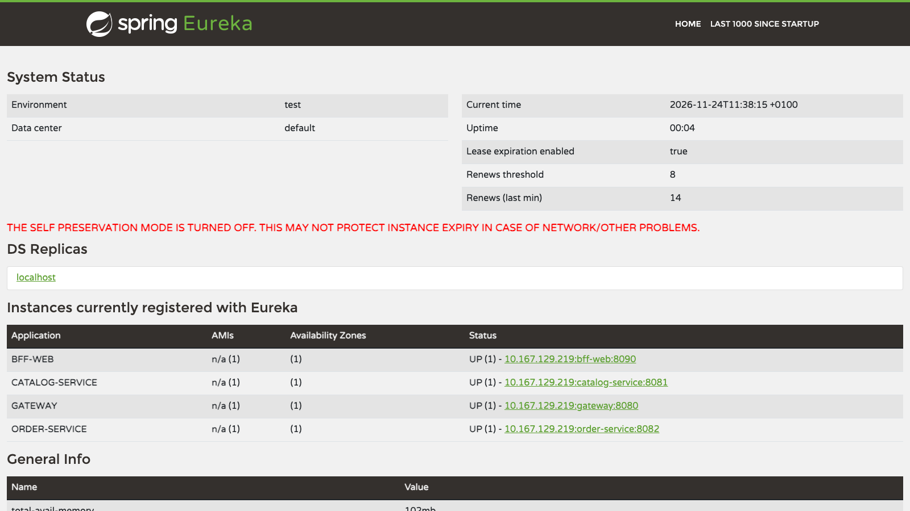
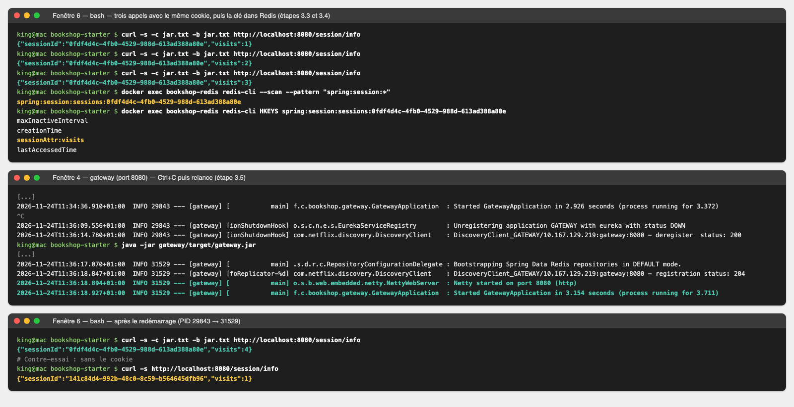
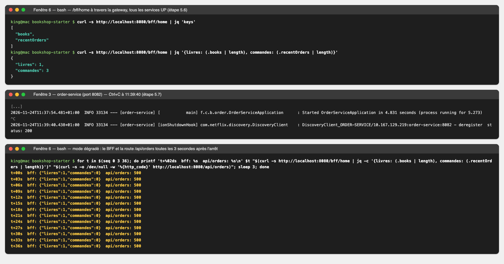

# TP4 – API Gateway, session Redis et BFF : rendu

INFAL112 – Projet bookshop-starter

Schémas explicatifs : [schemas/tp4-gateway-session-bff.drawio](schemas/tp4-gateway-session-bff.drawio), avec les onglets [architecture](schemas/tp4-1-architecture-gateway-bff.png), [session Redis](schemas/tp4-2-session-redis.png) et [gateway vs BFF](schemas/tp4-3-gateway-vs-bff-mode-degrade.png).

| Élément | Port | Rôle |
|---|---|---|
| `gateway` (nouveau module) | 8080 | Porte d'entrée unique (Spring Cloud Gateway, Netty) : `/api/books/**` et `/api/welcome` vers le catalogue, `/api/orders/**` vers les commandes, `/bff/**` vers le BFF |
| Redis (`bookshop-redis`) | 6379 | Stocke les sessions de la gateway (Spring Session) |
| `bff-web` (nouveau module) | 8090 | Assemble livres et dernières commandes pour la page d'accueil |
| `discovery-server`, `catalog-service`, `order-service` | 8761, 8081, 8082 | Ceux du TP3, inchangés |

> **Écart par rapport à l'énoncé** : avec l'`application.yml` de l'énoncé, `/actuator/gateway/routes` renvoyait `404`, et seul `health` était exposé. Dans Spring Cloud Gateway 4.1.5, la version tirée par Spring Cloud 2023.0.3, le endpoint `gateway` est désactivé par défaut (`management.endpoint.gateway.enabled`, `defaultValue: false` dans les métadonnées du jar). L'ajouter à `exposure.include` ne suffit donc pas. J'ai ajouté `management.endpoint.gateway.enabled: true` dans `gateway/src/main/resources/application.yml`.
>
> Au démarrage de la gateway, la ligne `ERROR ... Unable to load io.netty.resolver.dns.macos.MacOSDnsServerAddressStreamProvider` est propre à macOS (bibliothèque DNS native de Netty absente). Elle est sans effet ici et n'apparaît pas sous Windows.

## 1. La gateway et ses routes

La gateway démarre sur Netty, pas sur Tomcat, ce qui montre qu'elle tourne en mode réactif :

```
INFO 31529 --- [gateway] [main] o.s.b.web.embedded.netty.NettyWebServer : Netty started on port 8080 (http)
INFO 31529 --- [gateway] [main] f.c.bookshop.gateway.GatewayApplication : Started GatewayApplication in 3.154 seconds
```

Elle est inscrite dans l'annuaire, comme le BFF :



**Livrable 1** : les routes déclarées :

```
$ curl -s http://localhost:8080/actuator/gateway/routes | jq '.[].route_id'
"catalog"
"orders"
"bff"
```

Appels par la porte unique (étapes 2.3 et 2.4) :

```
$ curl -s http://localhost:8080/api/books | jq length
1
$ curl -s http://localhost:8080/api/orders | jq length
41
$ curl -s http://localhost:8080/api/welcome
Bienvenue (fichier interne)
$ curl -s http://localhost:8081/api/books | jq length
1
$ curl -s -X POST http://localhost:8080/api/orders -H "Content-Type: application/json" -d '{"bookId":1,"quantity":2,"customerId":"bob"}' | jq '{id, status, totalAmount}'
{
  "id": 69,
  "status": "CONFIRMED",
  "totalAmount": 30.00
}
```

Le nombre de livres est le même via 8080 et via 8081 : la gateway a seulement aiguillé la requête, sans la transformer. La commande a fait le trajet curl → gateway (8080) → annuaire → order-service (8082) → annuaire → catalog-service (8081).

> Remarque : juste après le premier démarrage de la gateway, ces appels ont renvoyé `503 Service Unavailable` pendant quelques secondes, le temps que la gateway télécharge le registre Eureka (même cache qu'au TP3). Attention : `jq length` affichait alors `5`, qui est le nombre de champs de l'objet d'erreur et non un nombre de livres.

## 2. La session dans Redis

**Livrable 2** : les trois appels avec le même cookie, la clé dans Redis, puis l'appel après le redémarrage de la gateway :



- Les trois appels renvoient le même `sessionId` (`0fdf4d4c-…`), avec `visits` qui passe de 1 à 3.
- Redis contient la clé `spring:session:sessions:0fdf4d4c-…`. C'est un hash dont le champ `sessionAttr:visits` porte le compteur et qui expire après 30 minutes d'inactivité (`maxInactiveInterval`).
- La gateway est arrêtée (Ctrl+C, PID 29843), puis relancée (PID 31529). Le même cookie renvoie le même `sessionId` avec `"visits":4` : le compteur a survécu à l'arrêt du processus, parce qu'il n'était pas en mémoire dans la gateway.
- Contre-essai : sans cookie, on obtient une nouvelle session (`141c84d4-…`) avec `"visits":1`.

## 3. Le BFF de la page d'accueil

**Livrable 3**, mode normal (tous les services UP) :

```
$ curl -s http://localhost:8080/bff/home | jq 'keys'
[
  "books",
  "recentOrders"
]
$ curl -s http://localhost:8080/bff/home | jq '{livres: (.books | length), commandes: (.recentOrders | length)}'
{
  "livres": 1,
  "commandes": 3
}
$ curl -s http://localhost:8080/bff/home | jq
{
  "books": [
    { "id": 1, "isbn": "9780132350884", "title": "Clean Code", "author": "Robert C. Martin", "price": 15.0 }
  ],
  "recentOrders": [
    { "id": 40, "bookId": 1, "quantity": 1, "customerId": "alice", "status": "CONFIRMED", "totalAmount": 15.0, "createdAt": "2026-11-24T08:41:54.645131Z" },
    { "id": 41, "bookId": 1, "quantity": 1, "customerId": "alice", "status": "CONFIRMED", "totalAmount": 15.0, "createdAt": "2026-11-24T08:41:54.665614Z" },
    { "id": 69, "bookId": 1, "quantity": 2, "customerId": "bob", "status": "CONFIRMED", "totalAmount": 30.0, "createdAt": "2026-11-24T10:35:51.773131Z" }
  ]
}
```

Un seul appel renvoie ce dont la page a besoin : le catalogue (au plus 5 livres) et les 3 dernières commandes, dont celle de bob passée à l'étape 2.4. Le BFF est joignable via la gateway environ 22 secondes après son démarrage (11:36:28 → 11:36:50).

Mode dégradé : order-service est arrêté (Ctrl+C) à 11:39:40, puis on appelle le BFF et, pour comparer, la route `/api/orders`, toutes les 3 secondes :



```
$ curl -s http://localhost:8080/bff/home | jq '{livres: (.books | length), commandes: (.recentOrders | length)}'
{
  "livres": 1,
  "commandes": 0
}
```

- Le BFF répond `200` dès l'arrêt et tout au long de l'essai. Les livres sont toujours là et la partie commandes est vide : l'exception levée par l'appel à order-service est attrapée dans `fetch()`, qui renvoie une liste vide. La page d'accueil reste affichable.
- Pendant ce temps, l'appel direct `/api/orders` via la gateway échoue. Il renvoie d'abord `500`, car la gateway envoie encore la requête à l'instance arrêtée, qu'elle garde en cache, et la connexion est refusée. Il passe à `503` environ 74 secondes après l'arrêt, une fois les caches rafraîchis (cache du client Eureka, puis cache de Spring Cloud LoadBalancer). La gateway ne fait qu'aiguiller : elle n'a pas de mode dégradé. C'est le BFF qui l'apporte.
- order-service est ensuite relancé : moins d'une minute après son démarrage (52 s), `/bff/home` renvoie de nouveau 3 commandes et `/api/orders` répond `200`.

## 4. En trois phrases

La gateway est une porte d'entrée unique et générique placée devant tous les services. Elle aiguille chaque requête vers le bon service, via l'annuaire et `lb://`, sans transformer les données, et c'est là qu'on posera les règles transverses (sécurité, logs, limites). Le BFF, lui, est un service applicatif propre à un type de client (ici la page d'accueil web) : il appelle plusieurs services, ne garde que ce dont l'écran a besoin, le renvoie en une seule réponse, et gère le mode dégradé si l'un d'eux tombe. La session est rangée dans Redis pour que la gateway soit sans état : la session survit à un redémarrage (`visits` est passé de 3 à 4 avec le même `sessionId`) et elle est partagée par toutes les copies de la gateway, qui peut donc être répliquée derrière un répartiteur de charge.

## Checklist de validation

| Vérification | OK ? |
|---|---|
| La gateway démarre sur Netty, port 8080, et apparaît dans Eureka | ☑ |
| `/actuator/gateway/routes` liste catalog, orders et bff | ☑ (après activation du endpoint, voir l'écart ci-dessus) |
| `/api/books` et `/api/orders` répondent via le port 8080 | ☑ |
| `/session/info` incrémente `visits` avec le même `sessionId` | ☑ |
| Une clé `spring:session:sessions:...` existe dans Redis | ☑ |
| Le compteur continue après redémarrage de la gateway | ☑ (`"visits":4`) |
| `/bff/home` renvoie `books` et `recentOrders`, et reste disponible si order-service est arrêté | ☑ |
